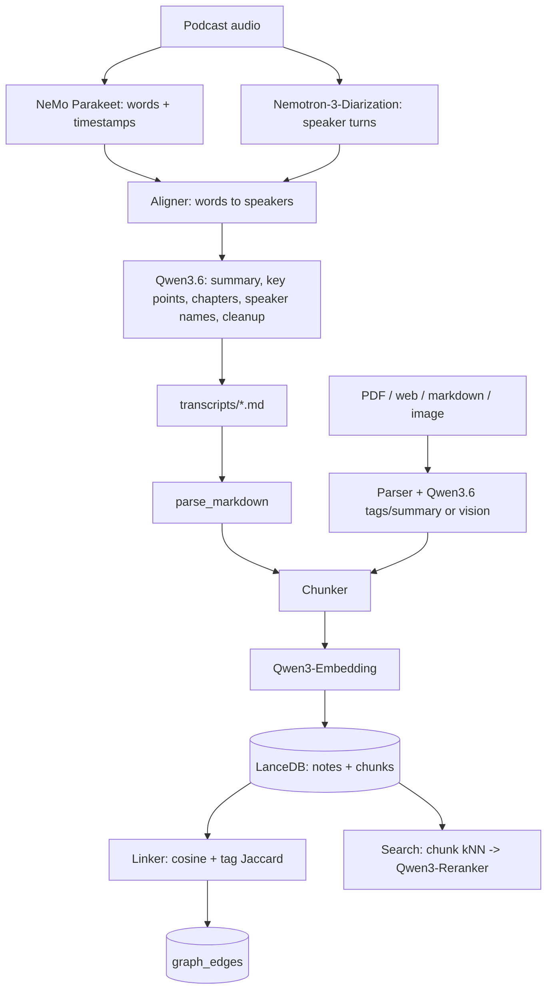

# Zettlecast Architecture

## Overview

Zettlecast is a local-first knowledge base for Windows + NVIDIA GPU. Every
processing step (transcription, diarization, LLM, embeddings, storage) runs on
the local machine.

| Layer | Technology |
|-------|-----------|
| API / CLI | FastAPI, Click (Python 3.12) |
| UI | Next.js 16, React 19, Sigma.js + graphology (ForceAtlas2) for the graph |
| Storage | Markdown files + LanceDB |
| ASR | NVIDIA Parakeet-TDT 0.6B (NeMo, local attention) |
| Diarization | NVIDIA Nemotron-3-Diarization (Sortformer) |
| LLM / vision | Qwen3.6-35B-A3B via Ollama |
| Search | Qwen3-Embedding-0.6B + Qwen3-Reranker-0.6B |

## Pipelines

All entry points (CLI, API, web UI) go through `pipeline.py`:

- `ingest_note(note)`: upsert note + chunks + vectors, then recompute its graph edges
- `ingest_path(path)`: parse a file (or queue it if audio) and ingest it
- `run_podcast_queue()`: process pending episodes end to end
- `reindex_all()`: rebuild the database from the transcript markdown files

### GPU scheduling

The 32 GB card can't hold the LLM (~22 GB) and NeMo (~14 GB for an hour of
audio) at once, so episodes are processed in phases: Ollama is unloaded, NeMo
transcribes and diarizes, NeMo frees its memory, then the LLM enhances. The
embedding and reranker models (~2.5 GB together) stay resident.

### Search

1. Embed the query (Qwen3-Embedding with its query instruction)
2. Cosine kNN over all chunks (top 50)
3. Rerank the chunk texts with Qwen3-Reranker
4. Return the best chunk per note, with the transcript timestamp when there is one

Transcript chunks keep their `[start] speaker:` header, so every hit says who
spoke and when.

### Graph

Each note's vector is the normalised mean of its chunk vectors. An edge's
weight is `0.7 * cosine + 0.3 * jaccard(tags)`. Edges above
`GRAPH_EDGE_THRESHOLD` are kept, up to `GRAPH_MAX_EDGES_PER_NOTE` per note,
directed from the older note to the newer one. Rejected pairs are stored and
never re-linked.

## Directory structure

See `AGENTS.md`.
